# Entra ID Access Review (P2)

Hands-on lab, October 2026 (done Oct 19).

## What this is and why it matters

An access review checks access people **already have** and removes what they no longer need. I ran a one-time review of the group **MFA-Test-Group** in Microsoft Entra ID P2. **Test User** was a member but hadn't signed in for 30+ days, so I denied continued access with a reason, and Entra removed them automatically. The group went from **1 member to 0**.

This is how companies keep access clean for audits: someone accountable confirms each person still needs access, and the removal is applied and logged, not done by hand. It rechecks access people already have. Requests for *new* access are a separate flow (approval / dual control, like in my CyberArk lab).

## Environment

| Item | Value |
| --- | --- |
| Tenant | Entra ID lab tenant with **Microsoft Entra ID P2** (needed for access reviews) |
| Review | **Q4 MFA-Test-Group** (Teams + Groups, scope: All users) |
| Reviewer | Lab Admin |
| Duration / recurrence | 3 days, one time, start 10/19/2026 |
| Member reviewed | Test User |

## Steps

### 1. Confirm the P2 license

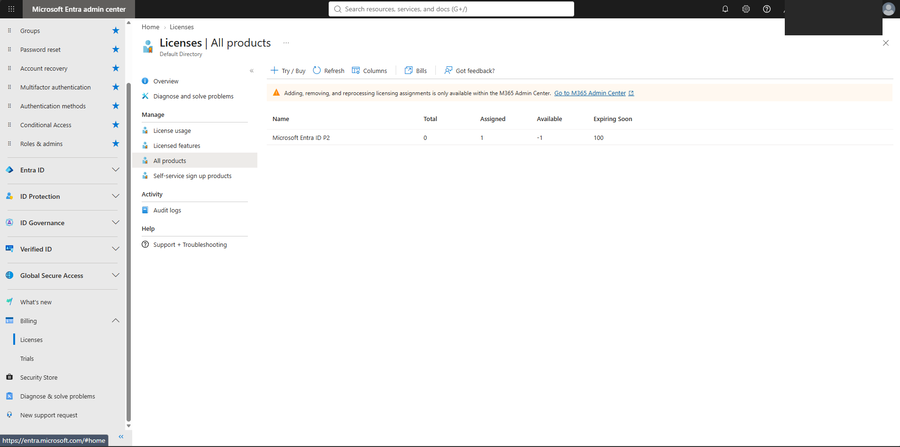

### 2. Identity Governance → Access reviews

### 3. Review type: Teams + Groups → MFA-Test-Group, All users

### 4. Reviewer: Lab Admin, 3 days, one time

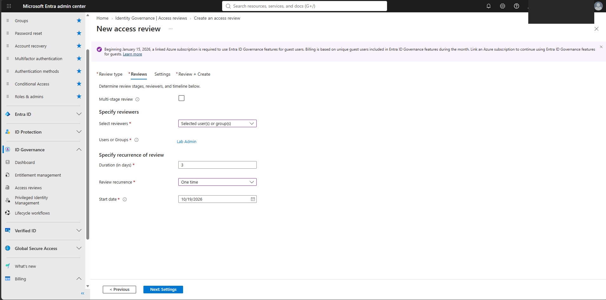

### 5. Settings

- Auto apply results to resource: **on**
- If reviewers don't respond: **No change**
- Decision helper: **No sign-in within 30 days**
- Justification required, email notifications and reminders: **on**

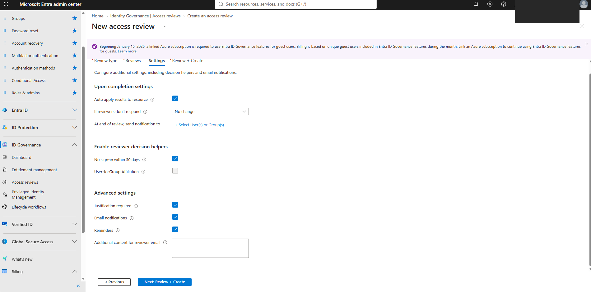

### 6. Review created, then active

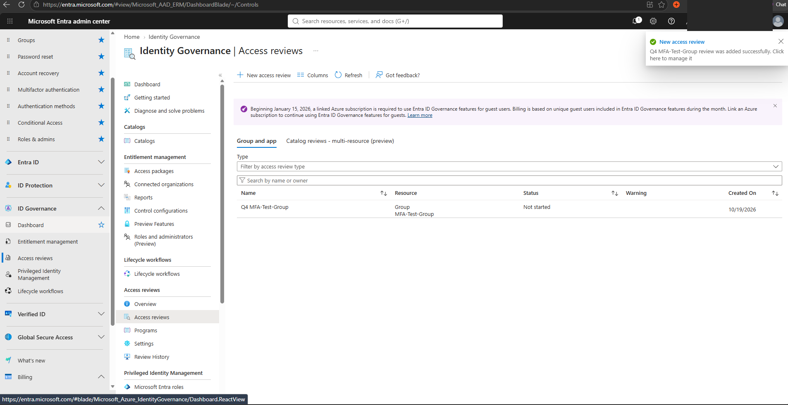
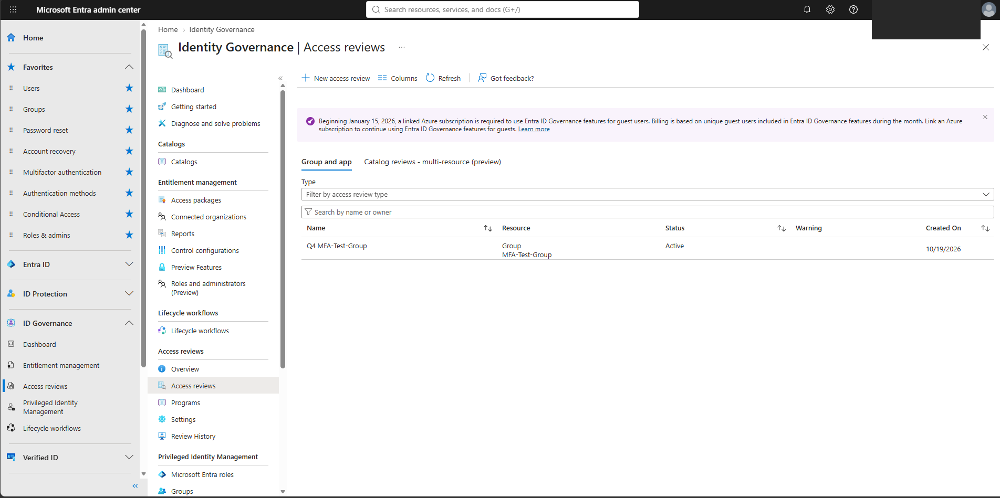

### 7. Before: MFA-Test-Group has 1 member (Test User)

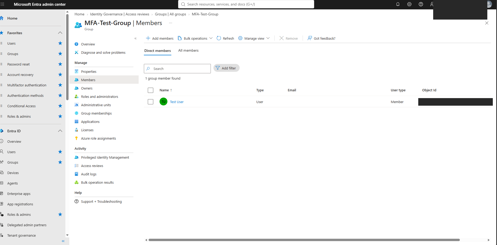

### 8. Reviewer decision in My Access: Deny, with a reason

Entra recommended **Deny** because Test User was inactive. I denied with the reason: *"Test account, no longer needs MFA testing access."*

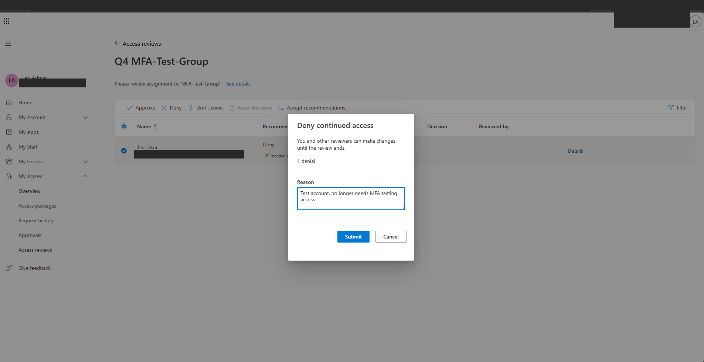
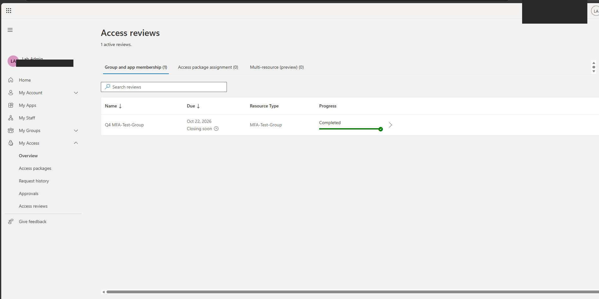

### 9. Stop the review → Complete, 1 denied

I stopped the review once the decision was in. **Apply** is grayed out because auto-apply was on, so Entra applied the deny by itself.

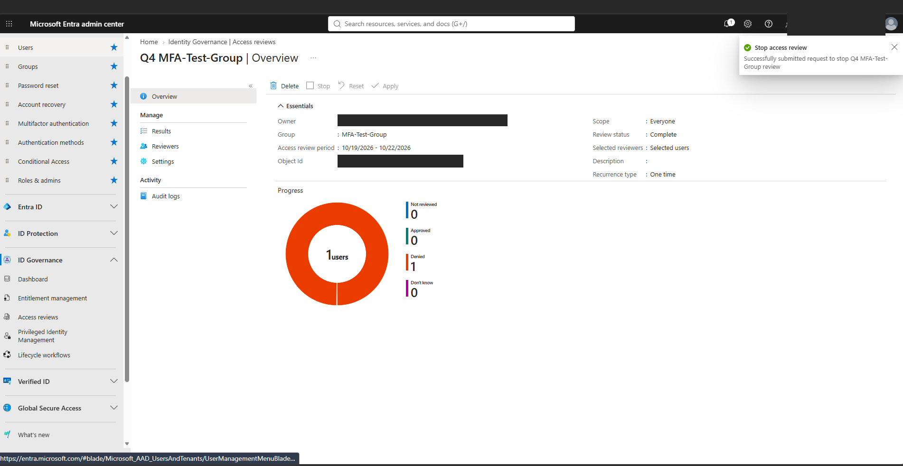
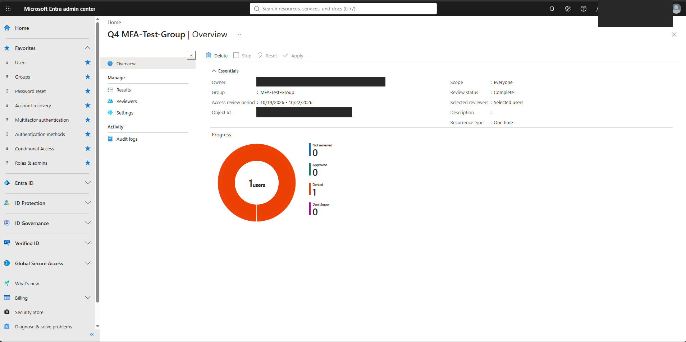

### 10. After: MFA-Test-Group has 0 members

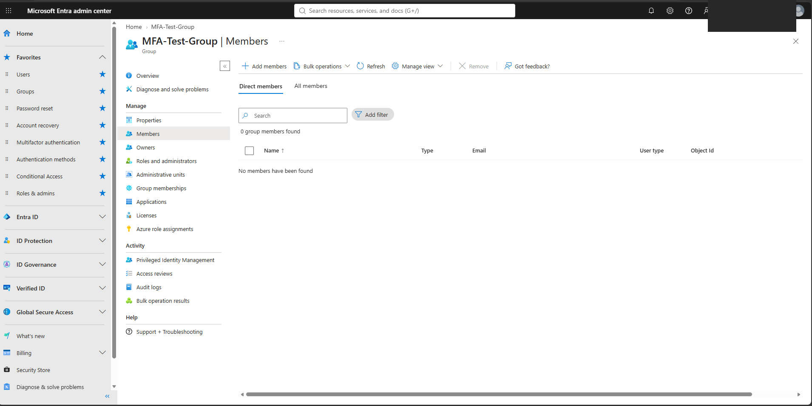

## What I got wrong at first, and fixed

At first I described this as denying someone who *requests* access. That's not what an access review is. It reviews access people **already have**. New requests go through an approval workflow instead. I corrected my understanding during the lab.

## Skills shown

- **IAM Support:** running a group access review, documenting a deny with justification, confirming removal
- **IAM Engineer / Identity Governance:** configuring Entra ID P2 access reviews (scope, reviewers, auto-apply, decision helpers)
- **PAM / least privilege:** removing inactive access automatically, audit-ready evidence
- Knowing the difference between access reviews (recertification) and access requests (approval)

## Notes

- Blacked out in screenshots: object IDs, review/tenant IDs in the browser URL, and the tenant name (account email and user names).
- Lab tenant and test accounts only; no real user data.
