# Entra ID Access Review (P2)

Hands-on lab, Oct 2026.

Audit question: does everyone in this group still need to be there? An access review answers that for access people **already have**. I ran a one-time review of **MFA-Test-Group** in Entra ID P2. Test User hadn't signed in for 30+ days, so I denied with a reason, and auto-apply removed them. The group went from 1 member to 0.

## What I built

- A one-time access review, **Q4 MFA-Test-Group** (Teams + Groups, all users), Lab Admin as reviewer, 3 days.
- Settings: auto-apply results **on**, no change if reviewers don't respond, decision helper "no sign-in within 30 days", justification required.
- As reviewer in My Access: denied Test User with the reason *"Test account, no longer needs MFA testing access."*
- Stopped the review, and it completed with 1 denied. Auto-apply removed Test User, and the group showed 0 members.

## What I learned

In my own words:

> "We did access review to be able to see we can deny if someone requests access, and we'll check to see if they're supposed to have it. We saw the group they wanted and we denied it, because that matters a lot, that we don't give access to people who aren't allowed to."

*Coach-written at his request (correction):* an access review checks access people **already have**. It isn't a new request. Test User was already in MFA-Test-Group, inactive 30+ days, denied with a reason, and auto-apply removed them. New requests go through an approval workflow instead (like dual control in my CyberArk lab).

*Interview line (coach-written at his request, from his one-page IAM Labs doc):*

> "I ran an Entra access review on a group, found an inactive user who still had access, denied it with a reason, and auto apply removed them. That keeps least privilege and stops old access from piling up."

## Key screenshots

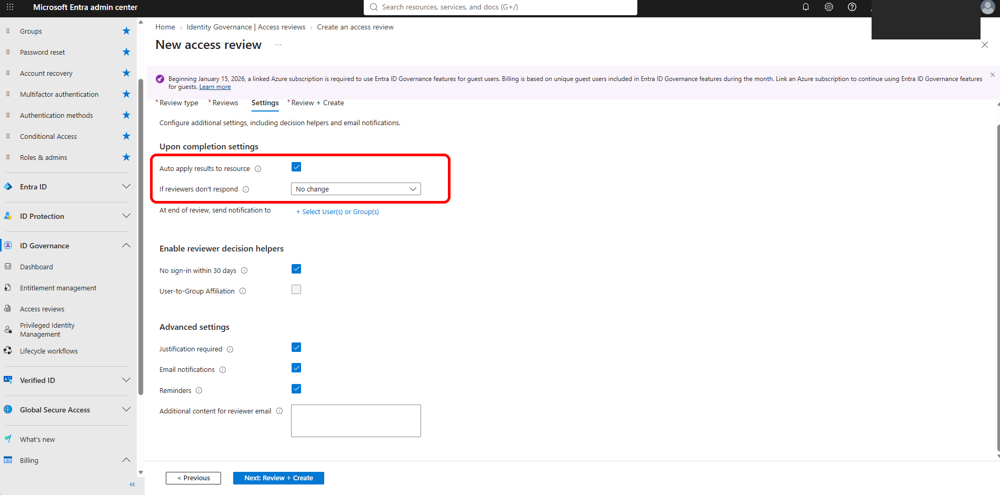
*Review settings auto-apply results so denied users lose access automatically.*

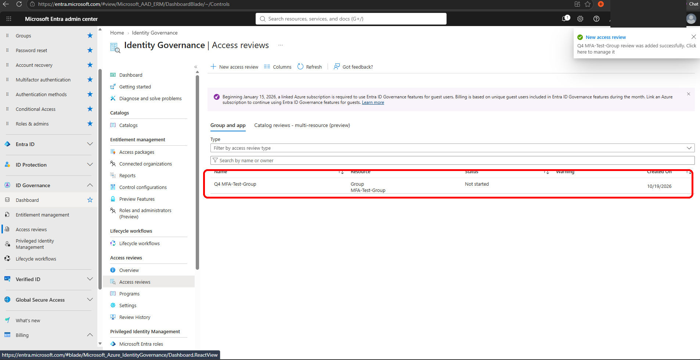
*Created a one-time access review for MFA-Test-Group members.*

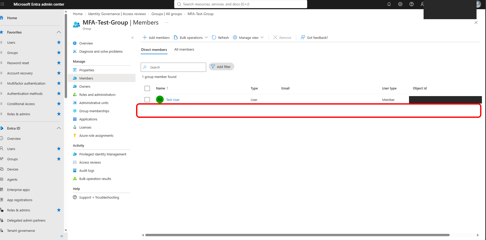
*Before the review, MFA-Test-Group has one member: Test User.*

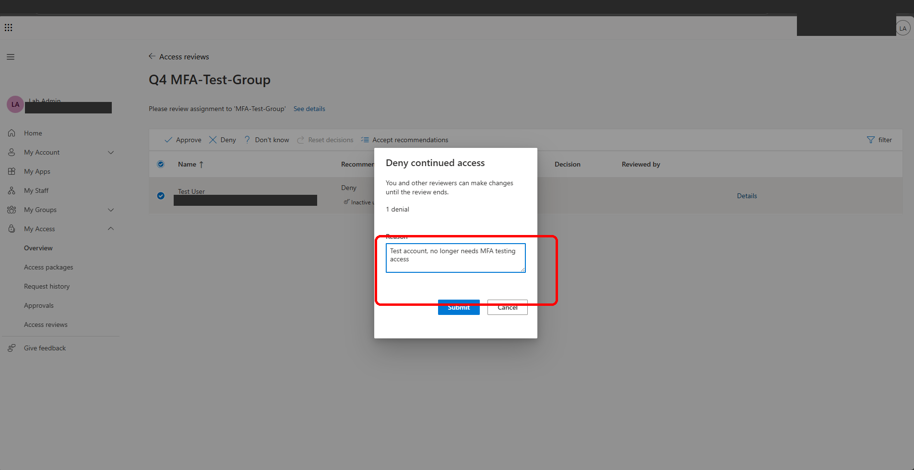
*As reviewer I denied Test User's access with a written reason.*

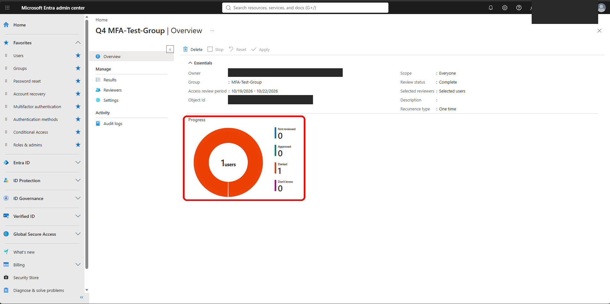
*Review completed with one user denied, recorded on the overview page.*

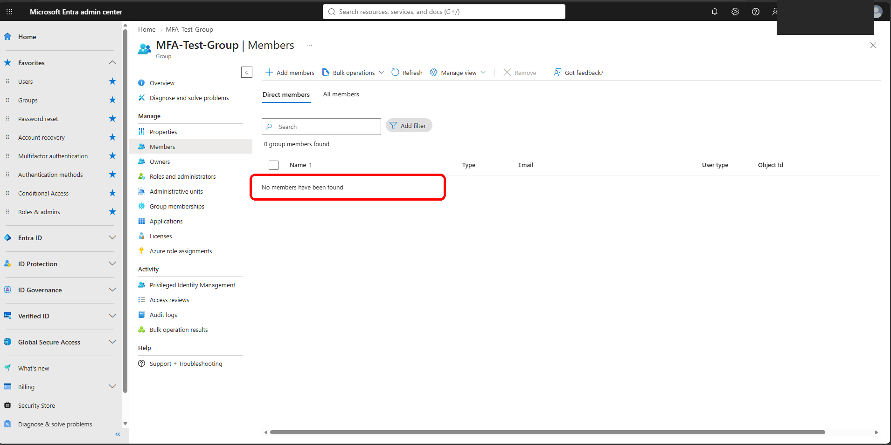
*After auto-apply, MFA-Test-Group has zero members: access removed.*

## Environment

| Item | Value |
| --- | --- |
| Tenant | Entra ID lab tenant with Microsoft Entra ID P2 |
| Review | Q4 MFA-Test-Group (Teams + Groups, all users) |
| Reviewer | Lab Admin |
| Duration / recurrence | 3 days, one time |
| Member reviewed | Test User |

## What broke / issues I fixed

- Nothing broke technically. What I fixed was my understanding: I first described it as denying a *request*. An access review re-checks *existing* access.

## Gaps

- One group and one member, in a lab tenant. No recurring review and no multi-reviewer setup shown.
- Blacked out in screenshots: tenant name, account email/UPNs, object/review/tenant IDs.

Full proof (all screenshots)

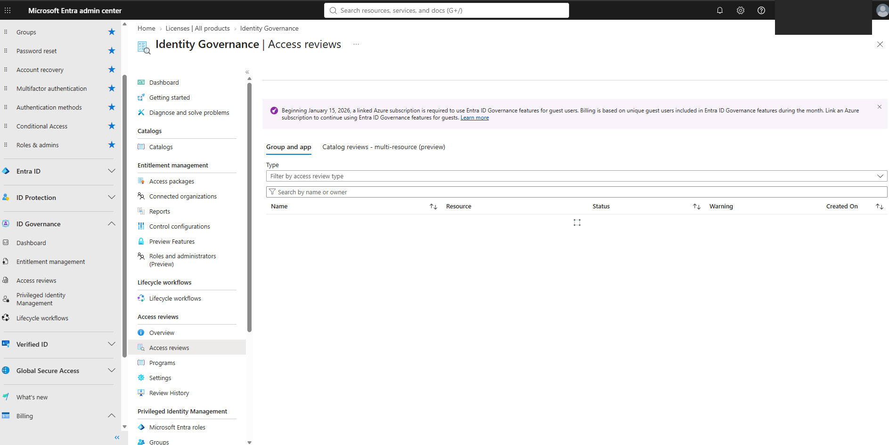

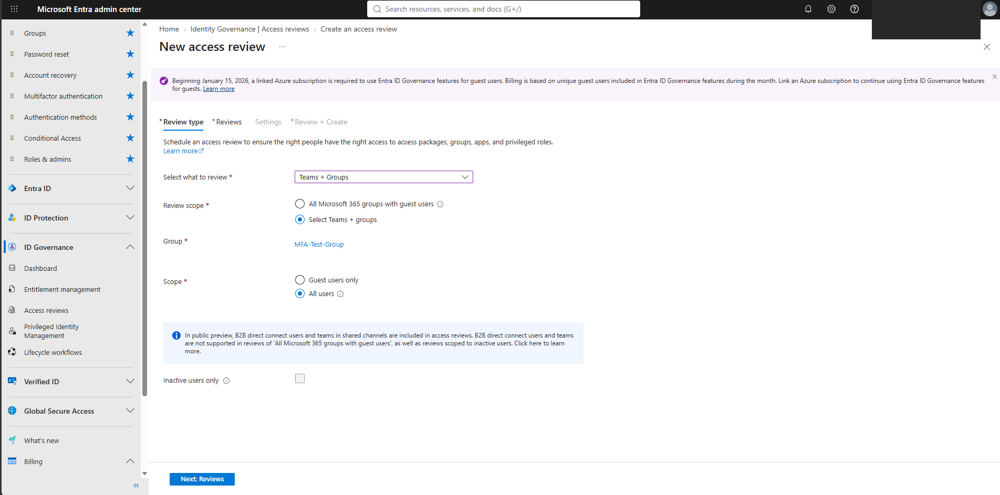

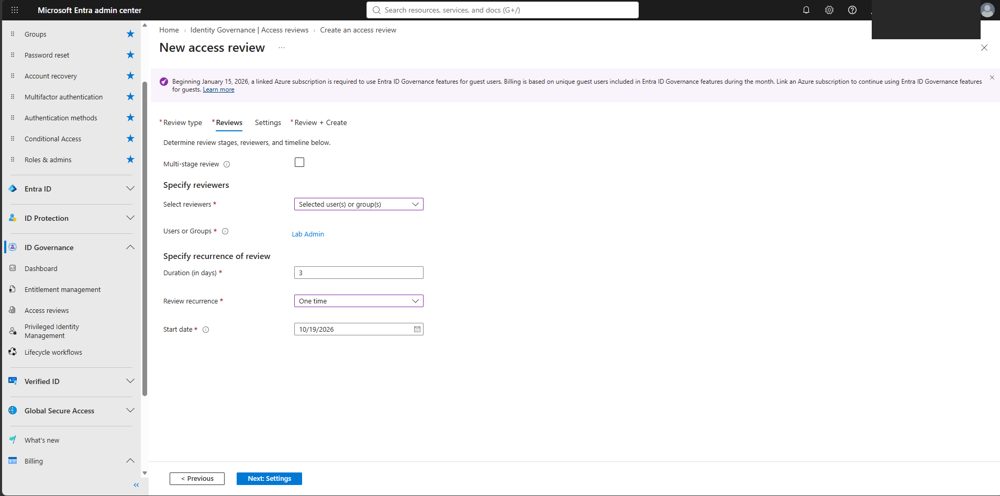

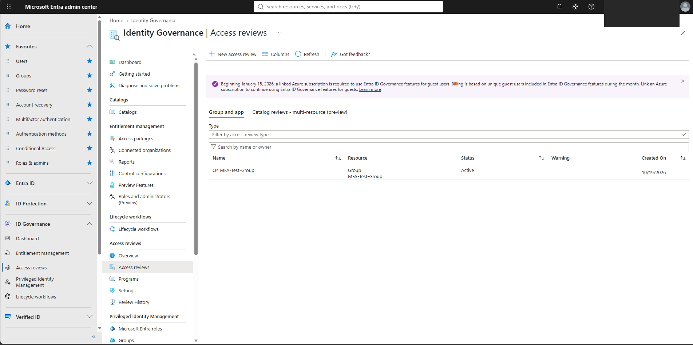

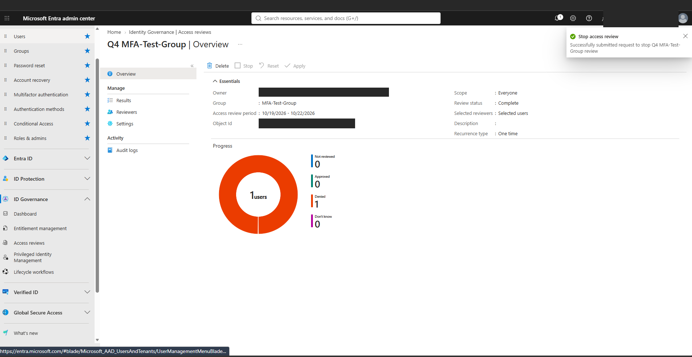

